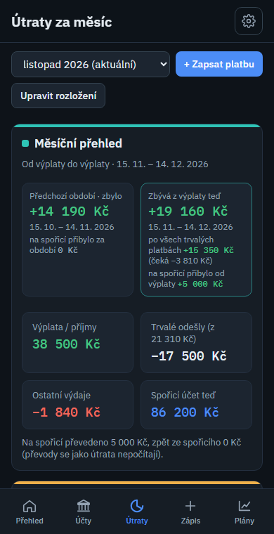
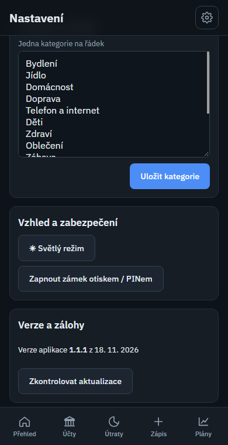

# Návod – Finance domácnosti

Aplikace ti ukáže, kolik ti zbývá z výplaty, kam jdou peníze, jak se daří spoření a investicím a co tě čeká za platby. Funguje na mobilu i na počítači.

**Tvoje data jsou jen tvoje.** Ukládají se do Google tabulky na tvém vlastním Disku Google. Aplikace nemá žádný server ani databázi a provozovatel tvoje data nevidí.

## 1. Otevření a instalace na plochu

Otevři odkaz **https://lervaz.github.io/finance/**.

Aplikaci si můžeš přidat na plochu. Pak se otevírá jako běžná aplikace, bez adresního řádku.

- **Android (Chrome):** vpravo nahoře klikni na **⋮** a vyber **Přidat na plochu** (nebo **Nainstalovat aplikaci**). Potvrď **Přidat**.
- **iPhone (Safari):** dole klikni na ikonu **Sdílet** (čtvereček se šipkou nahoru), sjeď níž a vyber **Přidat na plochu**. Vpravo nahoře potvrď **Přidat**.
- **Windows (Chrome nebo Edge):** v adresním řádku vpravo klikni na ikonu **Nainstalovat** (monitor se šipkou), nebo v menu **⋮ / …** vyber **Aplikace → Nainstalovat tento web jako aplikaci**.

## 2. Přihlášení přes Google

1. Klikni na **Přihlásit přes Google**. Stránka se přepne na Google.
2. Vyber svůj účet Google.
3. Google může napsat **„Google tuto aplikaci neověřil“**. Aplikace je zatím ve zkušebním provozu pro pozvané lidi. Klikni na **Pokračovat**.
4. Google ukáže, k čemu chce aplikace přístup. **Zaškrtni políčko u Disku Google** („zobrazit, upravit, vytvořit a smazat pouze konkrétní soubory na Disku Google, které s touto aplikací používáte“) a klikni na **Pokračovat**.
5. Stránka se vrátí zpátky do aplikace a jsi přihlášený.

**Co aplikace vidí a co ne:** vidí jen soubory, které sama založí – tedy svou tabulku „Finance – data“ a její zálohy. Tvoje ostatní soubory na Disku, e-maily ani fotky nevidí.

Přihlášení platí přibližně hodinu. Potom aplikace napíše, že přihlášení vypršelo – stačí znovu kliknout na **Přihlásit přes Google**, podruhé už se Google na nic neptá.

## 3. Výběr modulů a první vyplnění

Po prvním přihlášení tě provede průvodce:

1. **Co chceš sledovat?** Zaškrtni, co tě zajímá. Na začátek stačí **Účty**, **Útraty za měsíc** a **Trvalé platby**. Další moduly můžeš kdykoli zapnout v Nastavení.
2. **Kde máš peníze?** Napiš své banky a produkty (např. „Česká spořitelna, spořicí účet, stavební spoření“). Aplikace z toho založí účty.
3. **Základní čísla:** den výplaty, výše výplaty a zůstatky. Cokoli můžeš přeskočit a doplnit později.

Aplikace založí na tvém Disku tabulku **Finance – data**.

## 4. Každodenní používání

### Přehled

Na **Přehledu** je karta **Výplata** se dvěma čísly:

- **Minulé období** – kolik ti zbylo z minulé výplaty (nebo kolik jsi utratil navíc).
- **Zbývá z výplaty teď** – kolik ti z aktuální výplaty ještě zbývá.

Dál tu najdeš čisté jmění, spořicí účty, nejbližší platby a další karty podle zapnutých modulů.

### Zápis výplaty a plateb

Nahoře (na mobilu dole) klikni na **Zápis**. Vyber **Typ**, napiš **Za co**, **Částku** a **Datum** a klikni na **Přidat**.

- **Příjem (výplata apod.)** – výplata. Když ji zapíšeš, začne nové období a „Zbývá z výplaty teď“ začne od celé výplaty. Výplatu zapíšeš nejrychleji tlačítkem **Zapsat výplatu** na kartě Výplata.
- **Výdaj z běžného účtu** – nákup nebo platba z běžného účtu.
- **Výdaj placený ze spořicího** – nákup, na který sis vzal peníze ze spořicího účtu. Počítá se jako útrata.
- **Převod na spořicí** – poslání peněz na spořicí účet. **Není to útrata**, nic se neodečítá. Zůstatek spořicího účtu se sám zvýší.
- **Převod ze spořicího (není výdaj)** – peníze ze spořicího na trvalou platbu. Neodečítá se, protože trvalá platba už odečtená je.

Když si posíláš peníze ze spořicího na běžný účet kvůli nákupu, zapiš jen ten nákup jako **Výdaj placený ze spořicího**. Samotné poslání peněz nezapisuj, jinak by se odečetlo dvakrát.

Pokud výplatu nezapíšeš, aplikace po výplatním dni počítá s očekávanou výplatou a označí ji jako **odhad**.

### Útraty

Záložka **Útraty** ukazuje období od výplaty do výplaty: příjmy, trvalé platby (co už odešlo a co čeká), další platby a převody a kam šly peníze podle kategorií. Nahoře můžeš přepnout na starší období.

### Stavy účtů a investic

V **Zápis → Stavy** jednou za čas (třeba na konci měsíce) přepiš aktuální zůstatky účtů a hodnoty investic. Z nich se počítá změna za měsíc a zisk.

### Rozložení dlaždic

Na Přehledu, Účtech, Útratách i Plánech klikni na **Upravit rozložení**. Dlaždice pak můžeš přetahovat za úchyt **⠿**, měnit jim velikost za roh **◢** a skrýt je křížkem. Nakonec klikni na **Hotovo**.

## 5. Zámek, odhlášení a ztráta telefonu

**Zámek otiskem nebo PINem:** v **Nastavení → Vzhled a zabezpečení** klikni na **Zapnout zámek otiskem / PINem**. Když se pak k aplikaci vrátíš po víc než dvou minutách, odemkneš ji otiskem prstu, obličejem nebo PINem zařízení.

**Odhlášení:** vpravo nahoře je ikona **Odhlásit** (dveře se šipkou), hned vedle ozubeného kolečka. Data v tabulce zůstanou, jen se aplikace na tomto zařízení odhlásí.

**Když ztratíš telefon:**

1. Na počítači otevři **https://myaccount.google.com/permissions** a přihlas se.
2. Najdi aplikaci **Finance** a klikni na **Odebrat přístup**.
3. Přihlášení na ztraceném telefonu stejně vyprší nejpozději do hodiny a bez tvého účtu Google se znovu nepřihlásí.

Tvoje data zůstávají v tabulce na tvém Disku. Na novém telefonu se jen znovu přihlásíš.

## 6. Napojení banky

Automatické stahování pohybů z banky zatím není hotové a přijde v některé z dalších verzí. Do té doby se platby a zůstatky zapisují ručně. V **Nastavení → Co jde napojit** si můžeš ověřit, které tvoje banky půjde napojit.

## 7. Aktualizace a zálohy

- Když vyjde nová verze, aplikace ukáže dole lištu **„Je k dispozici nová verze“**. Klikni na **Aktualizovat**.
- Při každé nové verzi a před každou změnou struktury tabulky aplikace sama uloží **kopii tabulky** na tvůj Disk (posledních 10). Najdeš je v **Nastavení → Verze a zálohy → Zobrazit zálohy**.
- Záložní kopii můžeš otevřít v Google tabulkách a údaje z ní zkopírovat zpět. Když chceš celou zálohu použít místo současné tabulky, napiš provozovateli.

## 8. Časté potíže

- **„Google nepovolil přístup k souborům aplikace“** (nebo „Request had insufficient authentication scopes“) – při přihlášení nebylo zaškrtnuté políčko u Disku Google. Přihlas se znovu a políčko zaškrtni.
- **„Přístup zablokován“ / „aplikace nedokončila ověření“** – tvůj účet Google ještě není mezi pozvanými testery. Napiš provozovateli e-mail, kterým se přihlašuješ.
- **„Přihlášení vypršelo“** – přihlášení platí asi hodinu. Klikni na **Přihlásit přes Google**.
- **Čísla nesedí** – zkontroluj v **Útraty**, jestli je zapsaná výplata a jestli převody na spořicí nejsou zapsané jako výdaje. Pozor: co zapíšeš v jiné aplikaci nebo jinde, sem se samo nedostane.
- **Nejde se přihlásit v prohlížeči s blokováním** – aplikace se přihlašuje přepnutím stránky na Google, takže blokování vyskakovacích oken ani cookies třetích stran nevadí. Když přesto nejde, zkus jiný prohlížeč a napiš provozovateli.
- **Do tabulky můžeš nahlížet i psát ručně** (Nastavení → Data a účet Google → otevřít v Google tabulkách). Jen nepřejmenovávej listy a neměň první řádek s názvy sloupců.
