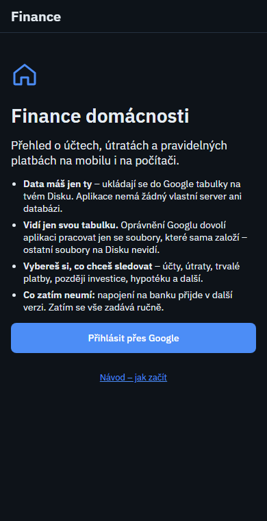
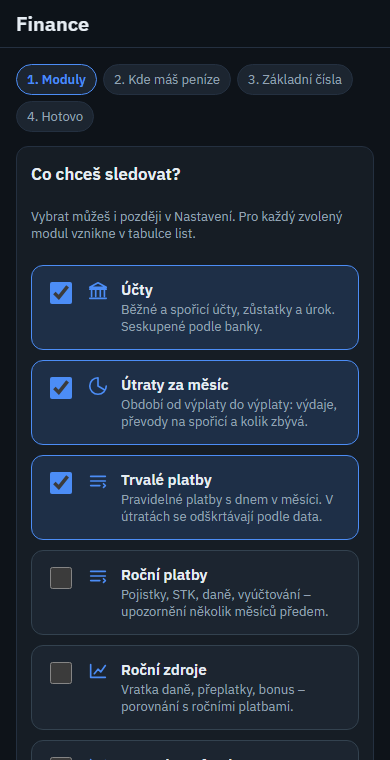
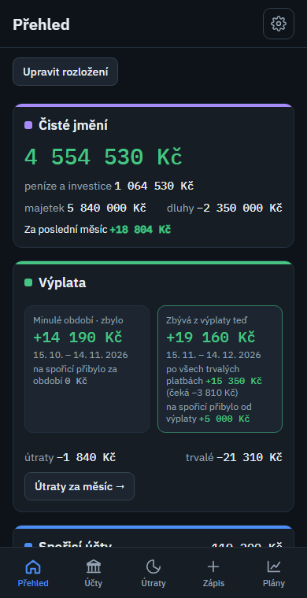
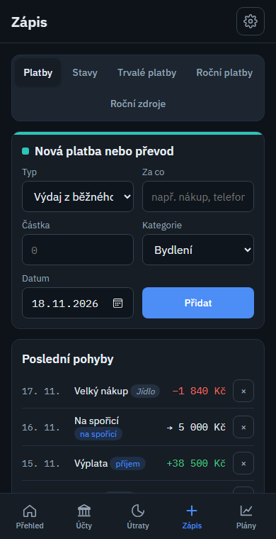

# Návod – Finance domácnosti

Aplikace ti ukáže, kolik ti zbývá z výplaty, kam jdou peníze, jak se daří spoření a investicím a co tě čeká za platby. Funguje na mobilu i na počítači.

**Tvoje data jsou jen tvoje.** Ukládají se do Google tabulky na tvém vlastním Disku Google. Aplikace nemá žádný server ani databázi a provozovatel tvoje data nevidí.

## 1. Otevření a instalace na plochu

Otevři odkaz **https://lervaz.github.io/finance/**.

Aplikaci si můžeš přidat na plochu. Pak se otevírá jako běžná aplikace, bez adresního řádku.

- **Android (Chrome):** vpravo nahoře klikni na **⋮** a vyber **Přidat na plochu** (nebo **Nainstalovat aplikaci**). Potvrď **Přidat**.
- **iPhone (Safari):** dole klikni na ikonu **Sdílet** (čtvereček se šipkou nahoru), sjeď níž a vyber **Přidat na plochu**. Vpravo nahoře potvrď **Přidat**.
- **Windows (Chrome nebo Edge):** v adresním řádku vpravo klikni na ikonu **Nainstalovat** (monitor se šipkou), nebo v menu **⋮ / …** vyber **Aplikace → Nainstalovat tento web jako aplikaci**.

## 2. Přihlášení přes Google

1. Klikni na **Přihlásit přes Google**. Stránka se přepne na Google.
2. Vyber svůj účet Google.
3. Google může napsat **„Google tuto aplikaci neověřil“**. Aplikace je zatím ve zkušebním provozu pro pozvané lidi. Klikni na **Pokračovat**.
4. Google ukáže, k čemu chce aplikace přístup. **Zaškrtni políčko u Disku Google** („zobrazit, upravit, vytvořit a smazat pouze konkrétní soubory na Disku Google, které s touto aplikací používáte“) a klikni na **Pokračovat**.
5. Stránka se vrátí zpátky do aplikace a jsi přihlášený.

**Co aplikace vidí a co ne:** vidí jen soubory, které sama založí – tedy svou tabulku „Finance – data“ a její zálohy. Tvoje ostatní soubory na Disku, e-maily ani fotky nevidí.

Přihlášení platí přibližně hodinu. Potom aplikace napíše, že přihlášení vypršelo – stačí znovu kliknout na **Přihlásit přes Google**, podruhé už se Google na nic neptá.

## 3. Výběr modulů a první vyplnění

Po prvním přihlášení tě provede průvodce:

1. **Co chceš sledovat?** Zaškrtni, co tě zajímá. Na začátek stačí **Účty**, **Útraty za měsíc** a **Trvalé platby**. Další moduly můžeš kdykoli zapnout v Nastavení.
2. **Kde máš peníze?** Napiš své banky a produkty (např. „Česká spořitelna, spořicí účet, stavební spoření“). Aplikace z toho založí účty.
3. **Základní čísla:** den výplaty, výše výplaty a zůstatky. Cokoli můžeš přeskočit a doplnit později.

Aplikace založí na tvém Disku tabulku **Finance – data**.

## 4. Každodenní používání

### Přehled

Na **Přehledu** je karta **Výplata** se dvěma čísly:

- **Minulé období** – kolik ti zbylo z minulé výplaty (nebo kolik jsi utratil navíc).
- **Zbývá z výplaty teď** – kolik ti z aktuální výplaty ještě zbývá.

Dál tu najdeš čisté jmění, spořicí účty, nejbližší platby a další karty podle zapnutých modulů.

### Zápis výplaty a plateb

Nahoře (na mobilu dole) klikni na **Zápis**. Vyber **Typ**, napiš **Za co**, **Částku** a **Datum** a klikni na **Přidat**.

- **Příjem (výplata apod.)** – výplata. Když ji zapíšeš, začne nové období a „Zbývá z výplaty teď“ začne od celé výplaty. Výplatu zapíšeš nejrychleji tlačítkem **Zapsat výplatu** na kartě Výplata.
- **Výdaj z běžného účtu** – nákup nebo platba z běžného účtu.
- **Výdaj placený ze spořicího** – nákup, na který sis vzal peníze ze spořicího účtu. Počítá se jako útrata.
- **Převod na spořicí** – poslání peněz na spořicí účet. **Není to útrata**, nic se neodečítá. Zůstatek spořicího účtu se sám zvýší.
- **Převod ze spořicího (není výdaj)** – peníze ze spořicího na trvalou platbu. Neodečítá se, protože trvalá platba už odečtená je.

Když si posíláš peníze ze spořicího na běžný účet kvůli nákupu, zapiš jen ten nákup jako **Výdaj placený ze spořicího**. Samotné poslání peněz nezapisuj, jinak by se odečetlo dvakrát.

Pokud výplatu nezapíšeš, aplikace po výplatním dni počítá s očekávanou výplatou a označí ji jako **odhad**.

### Útraty

Záložka **Útraty** ukazuje období od výplaty do výplaty: příjmy, trvalé platby (co už odešlo a co čeká), další platby a převody a kam šly peníze podle kategorií. Nahoře můžeš přepnout na starší období.

### Stavy účtů a investic

V **Zápis → Stavy** jednou za čas (třeba na konci měsíce) přepiš aktuální zůstatky účtů a hodnoty investic. Z nich se počítá změna za měsíc a zisk.

### Rozložení dlaždic

Na Přehledu, Účtech, Útratách i Plánech klikni na **Upravit rozložení**. Dlaždice pak můžeš přetahovat za úchyt **⠿**, měnit jim velikost za roh **◢** a skrýt je křížkem. Nakonec klikni na **Hotovo**.

## 5. Zámek, odhlášení a ztráta telefonu

**Zámek otiskem nebo PINem:** v **Nastavení → Vzhled a zabezpečení** klikni na **Zapnout zámek otiskem / PINem**. Když se pak k aplikaci vrátíš po víc než dvou minutách, odemkneš ji otiskem prstu, obličejem nebo PINem zařízení.

**Odhlášení:** vpravo nahoře je ikona **Odhlásit** (dveře se šipkou), hned vedle ozubeného kolečka. Data v tabulce zůstanou, jen se aplikace na tomto zařízení odhlásí.

**Když ztratíš telefon:**

1. Na počítači otevři **https://myaccount.google.com/permissions** a přihlas se.
2. Najdi aplikaci **Finance** a klikni na **Odebrat přístup**.
3. Přihlášení na ztraceném telefonu stejně vyprší nejpozději do hodiny a bez tvého účtu Google se znovu nepřihlásí.

Tvoje data zůstávají v tabulce na tvém Disku. Na novém telefonu se jen znovu přihlásíš.

## 6. Napojení banky

Napojení je **volitelné**. Aplikace pak sama stahuje zůstatky a platby z banky (4× denně) a ty platby jen potvrdíš. Bez napojení se vše zapisuje ručně.

**Co jde napojit:** jen platební účty v bance (běžný, obvykle i spořicí). Stavební spoření, hypotéka, fondy, penzijko a pojištění se takhle stáhnout nedají a zůstávají ruční. V **Nastavení → Co jde napojit** si ověříš své banky.

**Jak to funguje:** napojení zajišťuje služba **Enable Banking** (bezplatný režim pro vlastní účty). Každý si u ní zakládá **vlastní** přístup a vlastní klíč. Stahování obstarává malý skript přímo **v tvé tabulce** pod tvým účtem Google, takže bankovní data nejdou přes žádný cizí server. Platby ze skriptu se objeví v aplikaci v **Zápis → Z banky** a do útrat se dostanou až po tvém potvrzení.

> Nastavení zabere asi 20 minut a dělá se jednou. Postupuj krok po kroku.

### 6.1 Zapni modul

V aplikaci otevři **Nastavení → Moduly**, zaškrtni **Napojení na banku** a ulož. Aplikace se zeptá, jestli může do tabulky přidat listy `banka_ucty` a `banka_pohyby`, a potvrdíš. Předtím sama udělá zálohu tabulky.

### 6.2 Vlož skript do tabulky

1. V aplikaci otevři **Zápis → Z banky** a klikni na **Zkopírovat kód skriptu**.
2. Klikni na **Otevřít tabulku**. V tabulce nahoře vyber **Rozšíření → Apps Script**.
3. V editoru smaž všechno v souboru `Kód.gs` (`Code.gs`), vlož zkopírovaný kód (Ctrl+V) a klikni na ikonu **Uložit** (disketa).

### 6.3 Nasaď skript jako webovou aplikaci

Banka po přihlášení potřebuje adresu, kam tě vrátí. Tou bude tvůj skript.

1. V editoru Apps Script vpravo nahoře klikni na **Nasadit → Nové nasazení**.
2. U **Vyberte typ** (ozubené kolečko) zvol **Webová aplikace**.
3. **Spustit jako:** *Já*. **Kdo má přístup:** *Jen já*. Klikni na **Nasadit**.
4. Google chce povolení: **Autorizovat přístup** → vyber svůj účet → u „Google tuto aplikaci neověřil“ klikni na **Rozšířená nastavení → Přejít na … (nebezpečné)** → **Povolit**. (Je to tvůj vlastní skript.)
5. Zkopíruj **Adresu URL webové aplikace** (končí `/exec`).
6. V aplikaci Finance v **Zápis → Z banky** ji vlož do pole **Adresa skriptu** a klikni na **Uložit adresu**.

### 6.4 Zaregistruj se u Enable Banking

1. Otevři **https://enablebanking.com** a přihlas se (**Sign in**, přijde ti odkaz e-mailem).
2. V ovládacím panelu otevři **Applications** a zaregistruj novou aplikaci:
   - prostředí (**environment**): **Production**,
   - název: třeba *Finance*,
   - **Allowed redirect URLs:** adresa skriptu z kroku 6.3 (ta s `/exec` na konci),
   - nech si vygenerovat klíč. Prohlížeč stáhne soubor **.pem** – to je tvůj soukromý klíč. **Nikomu ho neposílej** a nikam jinam nenahrávej.
3. Poznamenej si **ID aplikace** (Application ID).
4. U aplikace klikni na **Activate by linking accounts** a propoj svou banku (přihlásíš se do internetového bankovnictví). Tím se aplikace zdarma aktivuje pro tvoje vlastní účty.

Přesné názvy tlačítek se u Enable Banking můžou trochu lišit.

### 6.5 Vlož ID a klíč do skriptu

1. V editoru Apps Script vlevo klikni na **Nastavení projektu** (ozubené kolečko).
2. Dole u **Vlastnosti skriptu** klikni na **Přidat vlastnost skriptu** a přidej dvě:
   - `EB_APP_ID` = ID aplikace z Enable Banking,
   - `EB_KLIC` = celý obsah souboru .pem (otevři ho v Poznámkovém bloku, Ctrl+A, Ctrl+C a vlož).
3. Klikni na **Uložit vlastnosti skriptu**.

### 6.6 Zkontroluj a připoj banku

1. Obnov stránku tabulky (F5). Nahoře se objeví menu **Banka**. Klikni na **Banka → Zkontrolovat nastavení** (poprvé znovu povolíš přístup). Má napsat „Nastavení je v pořádku“.
2. V aplikaci v **Zápis → Z banky** klikni na **Připojit banku**, vyber svou banku a přihlas se v ní. Na konci uvidíš **„Banka je připojená“**.
3. V tabulce klikni na **Banka → Zapnout automatické stahování (4× denně)**.
4. V aplikaci v **Zápis → Z banky** u každého bankovního účtu vyber, ke kterému tvému účtu patří. Od té doby se jeho zůstatek zapisuje sám.

### 6.7 Potvrzování plateb

Na **Přehledu** se ukáže karta **Z banky**, když čekají nové platby. V **Zápis → Z banky** má každá platba návrh:

- **Výdaj / Příjem** – zapíše se do útrat, u výdaje vyber kategorii. Aplikace si pamatuje, jak jsi dřív zařadil platby stejnému obchodu.
- **Už zapsáno – spárovat** – platbu jsi už zapsal ručně (stejná částka, datum ± 4 dny). Nezapíše se podruhé, jen se propojí.
- **Nezapisovat – trvalá platba** – trvalé platby se počítají z **Trvalých plateb**, zapsání by je odečetlo dvakrát.
- **Nezapisovat – převod mezi mými účty** – peníze jen přešly z jednoho tvého účtu na druhý.
- **Převod na spořicí** – převod z běžného na tvůj spořicí účet (není útrata).

Když návrh sedí, klikni na **Potvrdit vše**. Jinak ho u platby změň a potvrď ji tlačítkem **OK**.

### 6.8 Obnovení souhlasu a vypnutí

- Banka dává souhlas zhruba na **180 dní**. 14 dní předem aplikace upozorní. Klikni na **Obnovit souhlas banky** a přihlas se v bance znovu.
- **Vypnutí:** v tabulce **Banka → Vypnout automatické stahování**. Úplné zrušení: v ovládacím panelu Enable Banking aplikaci smaž a ve skriptu smaž vlastnost `EB_KLIC`. Už stažená data v tabulce zůstanou.

## 7. Aktualizace a zálohy

- Když vyjde nová verze, aplikace ukáže dole lištu **„Je k dispozici nová verze“**. Klikni na **Aktualizovat**.
- Při každé nové verzi a před každou změnou struktury tabulky aplikace sama uloží **kopii tabulky** na tvůj Disk (posledních 10). Najdeš je v **Nastavení → Verze a zálohy → Zobrazit zálohy**.
- Záložní kopii můžeš otevřít v Google tabulkách a údaje z ní zkopírovat zpět. Když chceš celou zálohu použít místo současné tabulky, napiš provozovateli.

## 8. Časté potíže

- **„Google nepovolil přístup k souborům aplikace“** (nebo „Request had insufficient authentication scopes“) – při přihlášení nebylo zaškrtnuté políčko u Disku Google. Přihlas se znovu a políčko zaškrtni.
- **„Přístup zablokován“ / „aplikace nedokončila ověření“** – tvůj účet Google ještě není mezi pozvanými testery. Napiš provozovateli e-mail, kterým se přihlašuješ.
- **„Přihlášení vypršelo“** – přihlášení platí asi hodinu. Klikni na **Přihlásit přes Google**.
- **Čísla nesedí** – zkontroluj v **Útraty**, jestli je zapsaná výplata a jestli převody na spořicí nejsou zapsané jako výdaje. Pozor: co zapíšeš v jiné aplikaci nebo jinde, sem se samo nedostane.
- **Nejde se přihlásit v prohlížeči s blokováním** – aplikace se přihlašuje přepnutím stránky na Google, takže blokování vyskakovacích oken ani cookies třetích stran nevadí. Když přesto nejde, zkus jiný prohlížeč a napiš provozovateli.
- **Banka: „Klíč je ve formátu RSA PRIVATE KEY“** – skript potřebuje klíč ve formátu „PRIVATE KEY“. Převeď ho příkazem `openssl pkcs8 -topk8 -nocrypt -in klic.pem -out klic-novy.pem` (OpenSSL je součástí Git pro Windows) a do `EB_KLIC` vlož obsah nového souboru.
- **Banka: po návratu z banky Google píše, že soubor nelze otevřít** – v prohlížeči jsi přihlášený víc účty Google. Otevři **Připojit banku** v anonymním okně, přihlas se jen svým účtem a zkus to znovu.
- **Banka: „limit stahování“** – banka povoluje stahování bez tebe jen pár krát denně. Skript počká 6 hodin a zkusí to sám.
- **Banka: platby se nestahují** – v tabulce zkus **Banka → Stáhnout teď**. Napíše, co je špatně (vypršený souhlas, chybějící klíč…).
- **Do tabulky můžeš nahlížet i psát ručně** (Nastavení → Data a účet Google → otevřít v Google tabulkách). Jen nepřejmenovávej listy a neměň první řádek s názvy sloupců.
